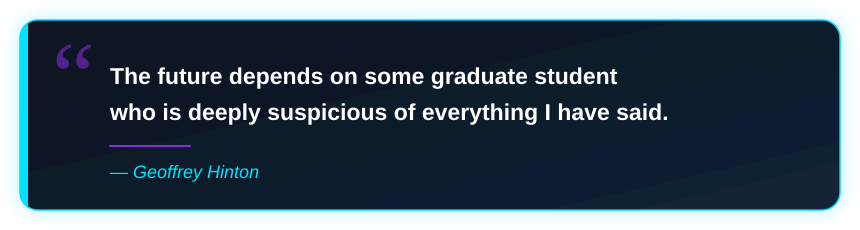

<!-- ===================== HEADER (animated wave) ===================== -->

<!-- ===================== TYPING ANIMATION ===================== -->

---

## 👨‍💻 About Me

🎯 **Goal:** Becoming a data scientist by building real, end-to-end ML projects.

🤖 **What I work with:** Classical machine learning — supervised and unsupervised learning, ensemble methods and recommender systems.

🤝 **Collaboration:** I'm looking to join data science projects, especially ML ones. I can contribute to EDA, feature engineering, modeling and evaluation. Using the data you provide, I will deliver an efficient model along with a clear report on its performance.

🌱 **Currently:**
- Learning deep learning: MLP, CNN, and NLP
- Writing an open-source machine learning guide: [ml-handbook](https://github.com/isapour0/ml-handbook)

⚙️ **How I work:** I am highly committed, execute projects step-by-step, and prioritize a clean project workflow.

---

## 🛠️ Tech Stack

---

## 🤖 Machine Learning

---

## 📊 GitHub Stats

---

## 💬 Quote

---

## 📫 Contact

<!--  -->

